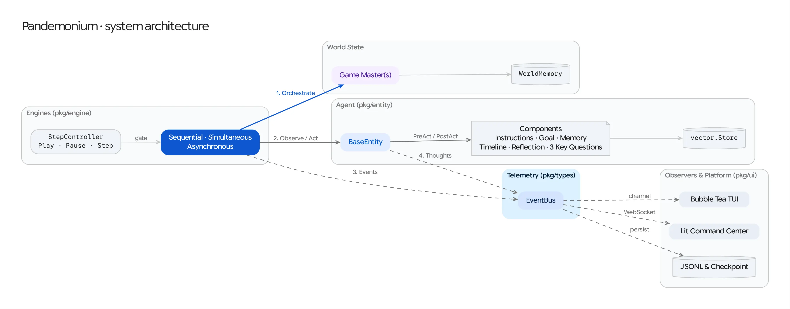

# Pandemonium: Generative Social Simulation in Go

Pandemonium is a high-performance, concurrent Go implementation of Google DeepMind's [**Concordia**](https://github.com/google-deepmind/concordia) generative social simulation library. It allows researchers and developers to build "digital pocket universes" where LLM-powered agents interact in grounded environments.

---

## 🚀 Key Features

- **Pluggable Orchestration Engines**: Run turn-based narrative loops (`sequential`), concurrent multi-actor rounds (`simultaneous`), or independent per-entity goroutine loops (`asynchronous`).
- **Concurrent Agent Lifecycle**: Uses goroutines to parallelize cognitive phases (`PRE_ACT`, `POST_ACT`, `UPDATE`), ensuring high performance as agent complexity grows.
- **Entity-Component Architecture**: Pure composition-based design. Agents and Game Masters are `Entity` implementations built from modular `ContextComponent` and `ActingComponent` building blocks.
- **Grounding, Memory & Reflection**: Combines Gonum-backed associative vector recall, rolling chronological `TimelineMemory`, periodic `ReflectionComponent` synthesis (sync or background async with belief-age tags), and goal-aware "Three Key Questions" perception.
- **Distributed A2A v2 Orchestration**: Seamlessly mix local in-process entities and remote microservices over the [A2A v2](https://github.com/a2aproject/a2a-go) JSON-RPC streaming protocol, complete with cross-network thought-artifact tunneling.
- **Multi-Layered Observability & Interactive Control**:
    - **TUI**: Reactive Bubble Tea terminal interface with real-time narrative logging and agent status view.
    - **Web Command Center**: Decoupled Lit frontend (`:8080`) with Play/Pause/Step/Stop `StepController` debugging, scenario launching, and live Trace Inspector via WebSockets & REST.
    - **JSONL & Checkpoints**: Persistent JSONL event traces (`-log`) and JSON step-boundary checkpointing (`-checkpoint` / `-resume`).



---

## 🛠 Project Structure

```text
go/
├── cmd/
│   ├── pandemonium/    # Simulation orchestrator CLI entry point
│   └── agent-node/     # Standalone A2A v2 agent microservice
└── pkg/
    ├── types/          # Core interfaces, EventBus, and Scenario config
    ├── entity/         # BaseEntity and remote A2AProxyEntity
    ├── component/      # Reusable building blocks (Memory, Timeline, Constant, Dynamic)
    ├── engine/         # Simulation loops (Sequential)
    ├── llm/            # LLM & Embedding providers (Gemini / Vertex AI)
    ├── vector/         # Vector storage (Gonum MemoryStore, FileStore, MarkdownStore)
    ├── store/          # Operational state stores (LocalStore, FirestoreStore)
    ├── prefab/         # Agent recipes, Scenario Loader, and embedded scenarios/
    └── ui/             # Bubble Tea TUI, WebSocket Server, and A2A Server
web/                    # Decoupled Lit/Vite Web X-Ray Frontend
docs/                   # Architecture guides, specifications, and tutorials/
```

---

## 🏃 Getting Started

1. **Configure Environment**:
   ```bash
   cp go/.env.example go/.env
   # Optional: set GOOGLE_CLOUD_PROJECT or GOOGLE_GENAI_API_KEY
   # (If left unset, Pandemonium runs in deterministic offline mock mode)
   ```

2. **Build Web Frontend** (optional, for Web UI support):
   ```bash
   cd web
   npm install
   npm run build
   cd ..
   ```

3. **Run a Simulation**:
   ```bash
   cd go
   go run ./cmd/pandemonium -log sim.jsonl
   ```

4. **CLI Flags**:
   - `-scenario`: Path to a YAML scenario file or built-in template name (default: `pub.yaml`).
   - `-log`: Path to save the simulation trace in JSONL format.
   - `-web`: Path to the web frontend build directory (default: `../web/dist`).
   - `-checkpoint`: Path to save a simulation checkpoint JSON after each step.
   - `-resume`: Path to a checkpoint JSON file to resume from.
   - `-start-paused`: Start the simulation in a paused state for interactive single-stepping via the Web Command Center or REST API.

5. **Observe**:
   - **Terminal**: Interactive TUI (Press `q` to exit).
   - **Browser**: Open `http://localhost:8080` for the Web X-Ray view.

---

## 📋 Task Tracking

This project uses **bd (beads)** for issue tracking.
- Run `bd list` to see the current backlog.
- Refer to `AGENTS.md` for AI-agent workflow instructions.

---

## 📖 Documentation

- **Tutorials (Hands-On & Validation Suite)**:
  - [Tutorials & Validation Track Overview](docs/tutorials/README.md)
  - [01: Running Your First Local Simulation](docs/tutorials/01-local-simulation.md)
  - [02: Hosting & Inspecting a Standalone A2A Agent Node](docs/tutorials/02-standalone-a2a-agent.md)
  - [03: Orchestrating a Distributed Simulation over A2A](docs/tutorials/03-distributed-simulation.md)
  - [04: Custom Scenarios, Turn Strategies & Persistent Memory](docs/tutorials/04-custom-scenarios-and-memory.md)
  - [05: Advanced Simulation Engines (`Simultaneous` & `Asynchronous`)](docs/tutorials/05-advanced-engines.md)
  - [06: Running AX-Sandboxed Simulations over A2A v2](docs/tutorials/06-ax-sandboxed-simulation.md)
- **Explanation & Architecture**:
  - [Project Primer](docs/PRIMER.md) - The TRPG analogy and high-level concepts.
  - [Go Adaptation Guide](docs/GO_ADAPTATION.md) - Technical implementation and roadmap.
  - [Combining Pandemonium, A2A v2, and AX](docs/AX_A2A_INTEGRATION.md) - Layered architecture and integration perspectives.
  - [Research Insights](docs/RESEARCH_INSIGHTS.md) - Deep dive into foundational papers.
- **How-To & Reference Guides**:
  - [A2A CLI (`a2acli`) Integration & Mocking Guide](docs/A2ACLI_INTEGRATION.md) - Inspecting, streaming, and mocking A2A v2 agents with `a2acli`.
  - [Scenario Specification](docs/SCENARIO_SPEC.md) - YAML schema for scenarios, engines, agents, and storage.


## Acknowledgements

This work is an adaptation of Google DeepMind's [Concordia](https://github.com/google-deepmind/concordia).

<!-- disableFinding(SNIPPET_INVALID_LANGUAGE) -->
```bibtex
@article{vezhnevets2023generative,
  title={Generative agent-based modeling with actions grounded in physical,
  social, or digital space using Concordia},
  author={Vezhnevets, Alexander Sasha and Agapiou, John P and Aharon, Avia and
  Ziv, Ron and Matyas, Jayd and Du{\'e}{\~n}ez-Guzm{\'a}n, Edgar A and
  Cunningham, William A and Osindero, Simon and Karmon, Danny and
  Leibo, Joel Z},
  journal={arXiv preprint arXiv:2312.03664},
  year={2023}
}
```

## Disclaimer

This is not an officially supported Google product.