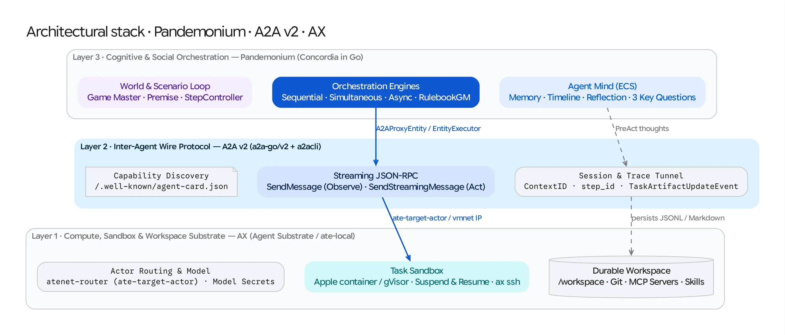

# Combining Pandemonium, A2A v2, and AX

This guide examines how **Pandemonium** (generative social simulation and Entity-Component-System cognition), **A2A v2** (the Agent-to-Agent wire protocol), and **AX** (declarative sandboxed task, workspace, and model orchestration on Agent Substrate) fit together as three complementary layers of a single distributed agent stack.

---

## 1. Architectural Layering: Why They Complement Each Other

Pandemonium, A2A, and AX operate at distinct architectural abstractions with no overlapping responsibilities:

| Layer | System | Primary Abstraction | What It Owns | What It Delegates |
| :--- | :--- | :--- | :--- | :--- |
| **Layer 3: Cognitive & Social Orchestration** | **Pandemonium** | `Entity`, `Component`, `Engine`, `Scenario`, `StepController` | Multi-agent turn-taking (`Sequential`, `Simultaneous`, `Asynchronous`), world grounding (`Game Master` / `RulebookGM`), and intra-agent ECS cognition (`Memory`, `Timeline`, `Reflection`, `ThreeKeyQuestions`). | Container isolation, filesystem setup, and network transport. |
| **Layer 2: Inter-Agent Wire Protocol** | **A2A v2** (`a2a-go/v2`) | `AgentCard`, `Task`, `Message`, `Artifact`, `ContextID` | Transport-agnostic capability discovery (`/.well-known/agent-card.json`), stateful task streaming (`SendStreamingMessage`), session correlation (`ContextID`), and reasoning trace tunneling (`TaskArtifactUpdateEvent`). | How an agent computes its response or where its container is scheduled. |
| **Layer 1: Compute, Sandbox & Workspace Substrate** | **AX** (`ax.io/v1alpha1`) | `Task`, `Workspace`, `Model`, `atenet-router`, `ate-local` | Sandboxed container execution (Apple `container` locally via `ate-local` or gVisor on Kubernetes), declarative Git/MCP/Skill workspace preparation, durable `/workspace` snapshotting across `ax suspend` / `ax resume`, and `ax ssh` inspection. | Multi-agent interaction topologies and internal cognitive loops. |

---

## 2. The A2A Protocol Perspective: The Bridge Between Mind and Sandbox

The **A2A v2** protocol is the linchpin that allows Pandemonium and AX to interoperate with **zero Go module coupling** between the two repositories:

1. **Self-Describing Sandboxes (`AgentCard`)**:
   - An AX `Task` running `cmd/agent-node` publishes its capabilities at `/.well-known/agent-card.json`.
   - Pandemonium's `NewA2AProxyEntityWithHeaders` validates the card via `agentcard.NewResolver` before Step 0 begins.
2. **Header-Driven Routing & On-Demand Wakeup (`ate-target-actor`)**:
   - In an AX cluster, tasks do not require dedicated Kubernetes `Service` or `Ingress` objects; requests route through `atenet-router` using the HTTP header `ate-target-actor: <atespace>/<task>`, which automatically resumes a `Suspended` actor before forwarding the request.
   - Setting `ate_target_actor: "default/agent-bob"` on an agent in a Pandemonium scenario YAML instructs `A2AProxyEntity` to attach `ate-target-actor: default/agent-bob` on every `AgentCard` and JSON-RPC request.
   - In a large-scale simulation with ratusan or thousands of agents where only a subset act on any given step, idle agents can remain `Suspended` in AX (consuming zero CPU/RAM) and wake on demand when `A2AProxyEntity` calls `Observe()` or `Act()`.
3. **Session & Clock Correlation (`ContextID` & `Metadata`)**:
   - Pandemonium's engine generates a simulation-wide `ContextID` (`a2a.NewContextID()`) and attaches `step_id` in the A2A `SendMessageRequest.Metadata` map so remote AX-hosted agents track turn progression across stateless or resumed invocations.
4. **Cross-Network Reasoning Trace Tunneling (`TaskArtifactUpdateEvent`)**:
   - While an agent acts inside an AX container, its `BaseEntity` executes `PreAct` across `Instructions`, `Goal`, `Memory`, `Timeline`, `Reflection`, and the *Three Key Questions* in parallel goroutines.
   - `ui.EntityExecutor` streams each component's output back over A2A as a named `TaskArtifactUpdateEvent`, which `A2AProxyEntity` re-emits onto the orchestrator's local `EventBus`—making the internal thoughts of a sandboxed remote agent visible in the local Bubble Tea TUI and Web Command Center (`:8080`).

---

## 3. Three Integration Perspectives

Depending on your audience and use case, Pandemonium and AX combine in three distinct patterns:

### Perspective 1: Infrastructure-First — AX Sandboxes Distributed Pandemonium Agents *(Implemented)*
**Target Audience**: Simulation researchers and platform engineers scaling multi-agent social simulations.

- **How it works**:
  - `ax-task-runner` runs as PID 1 inside each AX `Task` container (serving `/healthz`, `/readyz`, and optional `ax ssh` guest services) and launches Pandemonium's `cmd/agent-node` as `spec.command`.
  - Each agent configures its persistent `FileStore` (`/workspace/memories.jsonl`) or `MarkdownStore` (`/workspace/diary.md`) on AX's durable `/workspace` volume.
  - Because `/workspace` survives `ax suspend` and `ax resume`, suspending an agent container between turns (or across simulation runs) preserves its entire associative vector memory and chronological diary.
- **Hands-On Walkthrough**: See [Tutorial 06: Running AX-Sandboxed Simulations over A2A](tutorials/06-ax-sandboxed-simulation.md) and [`examples/ax/`](../examples/ax/).

---

### Perspective 2: Environment-First — Pandemonium Orchestrates Multi-Agent Workspaces in AX *(Architecture Outline)*
**Target Audience**: AI safety researchers, SWE-bench / red-team evaluators, and multi-agent tool-use designers.

- **Problem in Vanilla GABMs**: When an agent in a traditional text-only simulation says *"I patch the vulnerability in `auth.go` and run the unit tests,"* the Game Master hallucinates whether the code compiled or the exploit succeeded.
- **How Pandemonium + AX Solves It ("Grounded Digital Action Spaces")**:
  1. **Real Workspaces per Role**: Define an AX `Workspace` with a target Git repository, MCP servers, and skills. Bind it to multiple AX `Task` actors representing distinct personas and goals (e.g., `Alice` the Feature Author, `Bob` the Security Auditor, `Charlie` the SRE).
  2. **Deterministic Ground-Truth Resolution (`RulebookGM`)**: Instead of asking an LLM Game Master to guess the outcome of an action, implement Pandemonium's `engine.Rulebook` interface (`pkg/engine/rulebook.go`) to inspect the actual AX workspace state (via shared git refs, test runner outputs, or AX guest execution) and return objective observations (`MakeObservation`) and resolutions (`Resolve`).
  3. **Counterfactual Branching**: Pair Pandemonium's `engine.SaveCheckpoint` (`-checkpoint`) with AX task suspension/branching to fork a multi-agent engineering or red-team scenario at a critical turn and compare divergent strategies.

---

### Perspective 3: Cognitive-First — Pandemonium's ECS Mind Inside an AX Task Runner *(Architecture Outline)*
**Target Audience**: Agent framework authors building long-horizon autonomous workers on AX.

- **How it works**:
  - AX provides the `runner` Go package (`github.com/google/ax/runner`) so custom task images can embed the AX container contract while supplying their own cognitive loop.
  - A custom AX runner binary can instantiate Pandemonium's `entity.BaseEntity` (with `Constant` instructions/goals from `AX_TASK_YAML`, `AssociativeMemory` backed by `/workspace/memories.jsonl`, `TimelineMemory`, `ReflectionComponent`, and `ThreeKeyQuestions`) as its internal decision loop.
  - Every turn of the agent inside the AX sandbox automatically emits structured `types.Event` records (`observation`, `thought`, `action`) to `/workspace/trajectory.jsonl`, directly fulfilling AX's structured trajectory collection goals (`ax/docs/roadmap.md` §4).
