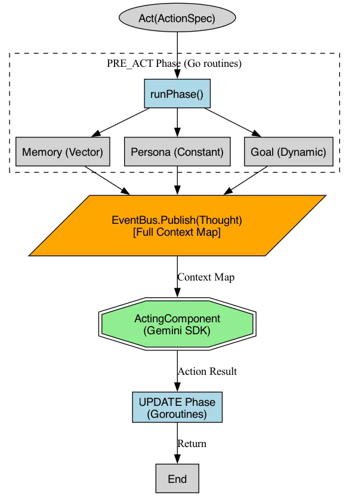
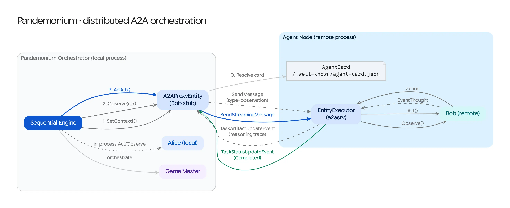

# Adapting Concordia to Go: Architectural Guide

This document outlines how to adapt the Python-based Concordia architecture into a robust, high-performance Go library (let's call it **Pandemonium**).

---

## 1. Core Interfaces: The Foundation

Go's implicit interfaces are perfect for Concordia's modular design.

### The Entity
In Python, this is a class. In Go, it's an interface that defines the contract for interaction.

```go
package pandemonium

// Entity represents any actor in the simulation (Agent or Game Master).
type Entity interface {
	Name() string
	// Act requests an action from the entity based on a spec.
	Act(ctx context.Context, spec ActionSpec) (string, error)
	// Observe provides information to the entity.
	Observe(ctx context.Context, observation string) error
}
```

### The Component
Components provide the context. We can use a more granular interface approach here.

```go
type Component interface {
	Name() string
}

type ContextComponent interface {
	Component
	PreAct(ctx context.Context, spec ActionSpec) (string, error)
	PostAct(ctx context.Context, action string) error
	PreObserve(ctx context.Context, observation string) (string, error)
	PostObserve(ctx context.Context) error
	Update(ctx context.Context) error
}
```

---

## 2. Phase Management & Concurrency

Concordia uses specific phases (`PRE_ACT`, `POST_ACT`, `UPDATE`). In Go, we can implement this using a `BaseEntity` struct and goroutines.



### Parallel Phase Execution
Because components are often independent (e.g., retrieving memory vs. checking goals), we can use goroutines and `sync.WaitGroup` or `errgroup` for performance.

```go
func (e *BaseEntity) Act(ctx context.Context, spec ActionSpec) (string, error) {
	// 1. PRE_ACT Phase (Parallel)
	contexts, err := e.callParallel(ctx, func(c ContextComponent) (string, error) {
		return c.PreAct(ctx, spec)
	})
	if err != nil {
		return "", err
	}

	// 2. GET_ACTION (The "Brain")
	action, err := e.Brain.GetAction(ctx, contexts, spec)
	if err != nil {
		return "", err
	}

	// 3. POST_ACT Phase (Parallel)
	_, err = e.callParallel(ctx, func(c ContextComponent) (string, error) {
		return c.PostAct(ctx, action)
	})
	
	// 4. UPDATE Phase
	// ... similar logic ...

	return action, nil
}
```

---

## 3. Library Structure & Package Organization

To encourage reuse and clear separation of concerns, follow a package-based structure:

```text
pandemonium/
├── cmd/                # Example binaries
├── pkg/
│   ├── engine/         # Simulation loops (Sequential, Simultaneous)
│   ├── entity/         # BaseEntity and common logic
│   ├── component/      # Reusable building blocks
│   │   ├── memory/     # Associative memory implementations
│   │   ├── observation/# Buffer management
│   │   └── thought/    # "Three Key Questions" logic
│   ├── prefab/         # Pre-wired configurations (Alice, GM, etc.)
│   ├── llm/            # LLM clients (OpenAI, Anthropic, Gemini)
│   └── vector/         # Vector store interfaces and implementations
```

---

## 4. Reuse and "Prefabs" in Go

In Go, "Prefabs" are best implemented as **Constructor Functions** or **Functional Options**.

### The Constructor Pattern
```go
// NewThreeKeyQuestionsAgent builds a standard agent with the famous reasoning chain.
func NewThreeKeyQuestionsAgent(name string, model llm.Model, db vector.Store) Entity {
	mem := memory.NewAssociativeMemory(db)
	obs := observation.NewLastN(10)
	
	components := map[string]ContextComponent{
		"Memory": mem,
		"History": obs,
		"Self": thought.NewSelfPerception(model),
		"Situation": thought.NewSituationPerception(model),
	}

	return &entity.BaseEntity{
		EntityName: name,
		Components: components,
		Brain:      brain.NewConcatBrain(model),
	}
}
```

---

## 5. Memory & Vector Operations

Pandemonium treats agent storage as a **pluggable strategy**. This allows the simulation to balance performance, auditability, and scale.

### The Storage Factory
Instead of a hardcoded vector store, the **Scenario Loader** uses a factory pattern to instantiate the appropriate store per agent:

- **MemoryStore (Gonum)**: High-performance, in-memory matrix operations for fast associative search.
- **MarkdownStore (Audit)**: Appends observations to human-readable `.md` files. Ideal for "Long Context" models where the entire history is sent to the LLM.
- **FileStore (JSONL)**: Persistent JSONL backing for the MemoryStore, allowing agents to "remember" between simulation restarts.
- **VertexVectorStore (Cloud)**: Scalable search for simulations with millions of memories.

### Performance vs. Context
By supporting multiple strategies, Pandemonium caters to both traditional RAG-based architectures (Associative) and modern Long-Context models (Timeline/Markdown).

---

## 6. Prompt Engineering (The Go Way)

Instead of Python's f-strings, use `text/template`. This allows you to externalize prompts into `.tmpl` files, making it easier to "tune" the agents without re-compiling.

```go
var actTemplate = template.Must(template.New("act").Parse(`
Instructions: {{.Instructions}}
Relevant Memories: {{.Memory}}
Current Situation: {{.Situation}}

Based on the above, what does {{.Name}} do?
`))
```

## 7. UX & Observability: CLI, TUI, and Web

Pandemonium supports a layered observability strategy.

### The Event Bus
To support multiple real-time viewers, the engine uses an `EventBus` to broadcast `types.Event` objects.
- **Subscribers**: Bubble Tea TUI, WebSocket Server, JSONL File Logger.

### The TUI (Interactive Feedback)
Built with `charmbracelet/bubbletea`, the TUI provides:
- A scrolling narrative viewport.
- A real-time agent status sidebar.
- Color-coded event types (Senses, Actions, World Outcomes).

### The Web UI (Decoupled Frontend)
- **Technology**: Lit-based WebComponents.
- **Location**: Located in the root `web/` directory, decoupled from Go source.
- **Server**: The Go binary serves static files via the `-web` flag and broadcasts events via WebSockets.

---

## 8. Memory Storage & Retrieval

### Local-First (Development)
- **Log**: Simple JSONL file for persistence.
- **Index**: In-memory vector store using `gonum` for cosine similarity.

### Cloud-Scale (Production)
- **Log**: **Google Cloud Firestore** for document-style memory storage.
- **Index**: **Vertex AI Vector Search** for massive-scale associative retrieval.

---

## 9. Phased Roadmap

### Phase 1: Core Engine ("Snowed-in Pub")
- **Goal**: Terminal-based simulation with 3+ agents.
- **Focus**: Interface stability, sequential engine, and in-memory memory.

### Phase 2: Observability ("The X-Ray")
- **Goal**: Real-time visualization of agent reasoning.
- **Focus**: Local web server, WebSocket event stream, and Lit-based Trace Inspector.

### Phase 4: The Pandemonium Platform
- **Goal**: Multi-tenant server capable of managing scenario libraries and concurrent simulation sessions.
- **Focus**: Simulation Manager, REST/gRPC API, and a full "Command Center" Web UI.

### Phase 5: A2A Distributed Orchestration
- **Goal**: Cross-service agent orchestration using the A2A (Agent-to-Agent) protocol.
- **Focus**: A2A Proxy entities, service wrappers for local entities, and ContextID/Task correlation.

---

## 10. Distributed Simulation Architecture (A2A)

Pandemonium supports distributed simulations where agents can be hosted as standalone microservices by colleagues. This is achieved via the **A2A (Agent-to-Agent)** protocol.

### Remote Entity Proxy (The Stub Pattern)
Remote agents are integrated using an `A2AProxyEntity` which implements the `Entity` interface but delegates all calls to a remote URL. The engine remains agnostic to whether an agent is local or remote.



### Conceptual Correlation Mapping

To maintain idiomatic alignment with the A2A SDK, Pandemonium maps simulation concepts as follows:

| Pandemonium Concept | A2A Concept | Implementation Detail |
| :--- | :--- | :--- |
| **Simulation Session** | **ContextID** | Groups all turns/tasks in a single run. |
| **Agent Turn (Act)** | **Task** | Each `Act()` call creates a stateful Task. |
| **Observation** | **Message (User)** | The GM's observation is sent as a user-role message. |
| **Action Result** | **Message (Agent)** | The agent's final action completes the Task. |
| **Reasoning (Trace)** | **Artifacts** | "Three Key Questions" data are emitted as Artifacts. |
| **Sim Clock** | **Metadata** | `StepID` is carried in the A2A Metadata container. |

### Distributed Session Management (A2A)

To maintain narrative continuity across the network, Pandemonium utilizes A2A's stateful session capabilities:

1.  **Shared ContextID**: At the start of a simulation, the `Sequential` engine generates a unique `ContextID`. This ID is synchronized with all `A2AEntity` proxies.
2.  **Turn Tracking**: Every remote `Act()` call is initiated as an A2A **Task** linked to that `ContextID`.
3.  **Simulation Clock**: The engine passes the `step_id` in the A2A **Metadata** container for every network call. This allows remote agents to understand the temporal sequence of the simulation (e.g., "This is turn 5").
4.  **Trace Tunneling**: The `A2AServerWrapper` captures internal agent "Thoughts" from its local event bus and publishes them as **A2A Artifacts**. The local `A2AProxyEntity` transparently translates these back into Pandemonium events, making remote reasoning visible in the local dashboard.

### Scenario Setup Phase (Initialization)

Pandemonium mirrors Concordia's **`INITIALIZER`** role through a formal **Setup Phase (Step 0)**:

1.  **Formative Grounding**: Before the first turn, the engine broadcasts the full `premise` and `world_facts` to every participant.
2.  **Memory Seeding**: For local agents, this observation is automatically stored in their `AssociativeMemory`.
3.  **Remote Compatibility**: For A2A remote agents, this provides an explicit "System Message" they can use to initialize their own internal state or custom memory implementations.
4.  **Divergence**: While Concordia often uses a separate GM entity for initialization, Pandemonium simplifies this by making it a standard engine lifecycle event, ensuring all distributed agents are synchronized before the first action.

---

## 11. Persistence Strategy

Pandemonium utilizes a **Dual-Persistence** model to balance cognitive realism with operational reliability.

### Associative Memory (Vector)
- **Purpose**: Agent cognition and semantic recall.
- **Implementation**: `pkg/vector/Store` interface.
- **Providers**: In-memory (Dev), Vertex AI Vector Search (Prod).

### Operational State (Document/SQL)
- **Purpose**: Scenario templates, session metadata, event logs, and user data.
- **Implementation**: `pkg/store/StateStore` interface.
- **Providers**: Local JSONL/Files (Dev), Google Cloud Firestore (Prod).

---

## 11. Multi-Tenant Orchestration

Moving from a CLI tool to a Platform requires a **Simulation Manager**:
- **Lifecycle**: Spawns and kills simulation goroutines.
- **Isolation**: Ensures each session has its own `EventBus` and `MemoryStore`.
- **Switchboard**: A central registry that allows UI clients to "attach" to specific session streams via a `/ws/:session_id` endpoint.

---

## 13. Thinking Models & "Zero Mock" Policy

To achieve high-fidelity social simulations, Pandemonium is moving away from "Hardcoded Fallbacks" (e.g., character-specific strings in code) toward **Direct Model Steering**.

### Native System Instructions
Every entity (Agent or GM) utilizes the native **System Role** of the Gemini SDK. The Go engine maps the "Instructions" component output directly to this role. This ensures that even "General Purpose" models like Gemini 3 Flash can behave as specialized characters without custom Go logic.

### From Mocks to Semantic Reality
The initial `MockEmbedder` (length-based) is being replaced with `gemini-embedding-001`. This moves the simulation from "keyword matching" to "semantic understanding," where an agent can recall a memory of "winter" when they observe "snow."

---

## 14. Generative Memory: A Phased Approach

Pandemonium iterates on Concordia's memory bank concepts through a multi-stage technical roadmap:

| Stage | Name | Description | Concordia Alignment |
| :--- | :--- | :--- | :--- |
| **3.2** | **Grounding** | `gemini-embedding-001` + `gonum`. Enables real semantic retrieval. | **Core Match** |
| **3.3** | **Formative** | Support for `formative_memories` in Scenario YAML. Seeds the vector store at boot. | **Core Match** |
| **3.4** | **Reflections** | A specialized component that periodically summarizes recent history into new high-level memories. | **Divergence** (Go-native) |
| **3.5** | **Cloud Scale** | Vertex AI Vector Search for multi-scenario, long-term agent persistence. | **Scale Match** |

---

## 16. Context Curation vs. Associative Recall

With the advent of large context windows (1M+ tokens), Pandemonium diverges from early RAG patterns by supporting two distinct memory strategies:

### Chronological Context (Timeline)
- **Goal**: Functional situational awareness.
- **Mechanism**: A rolling buffer of the last $N$ turns or a full-text history.
- **Best for**: Short-running scenarios and maintaining narrative flow.

### Associative Recall (Semantic)
- **Goal**: Cognitive realism and long-term character depth.
- **Mechanism**: Vector embeddings (`gemini-embedding-001`).
- **Best for**: "Digital Life" simulations where agents must relate disparate events across large temporal gaps (e.g., "This storm reminds me of the one from my childhood").

### The Hybrid Approach
Standard Pandemonium agents are encouraged to use **both**. The Timeline provides the "Short-term" facts, while the Associative store provides "Long-term" intuition.

### Phase 6: Advanced Simulation Engines
- **Goal**: Port complex orchestration patterns from Concordia.
- **Focus**: Concurrent multi-actor turns, Multiple GMs, and Real-time asynchronous loops.

---

## 18. Advanced Orchestration Engines

Pandemonium supports multiple engine types to facilitate different research and simulation goals:

### Sequential (The Narrative default)
The standard turn-based loop where one agent acts at a time. Ideal for deep narrative and focused social interactions.

### Simultaneous (The Competitive default)
Allows multiple agents to act concurrently within a single step. 
- **Aggregation**: The Game Master receives all agent actions as a single combined context for world resolution.
- **Concurrency**: Leverages Go's goroutines to parallelize the "Internal Monologues" of all active agents.

### Ticker (The Real-Time Engine)
A clock-driven loop where agents act asynchronously based on their "reaction time" or events in the environment. This moves the simulation from a discrete "Board Game" style to a continuous "Digital Twin" style.

### GM Switcher
Support for multiple Game Masters, allowing the engine to select different "Rule Sets" (GM Entities) based on the simulation's current state.

---

## 19. Key Advantages of a Go Version

1.  **Strict Typing**: Prevents common "stringly-typed" errors in complex component interactions.
2.  **Performance**: Handling 100+ agents in a simultaneous engine will be significantly faster and use less memory than the Python equivalent.
3.  **Deployment**: A single statically linked binary is much easier to deploy than a Python environment with complex C-dependencies for vector math.
4.  **Observability**: Use Go's `context` for cancellation and tracing across the entire simulation chain.
