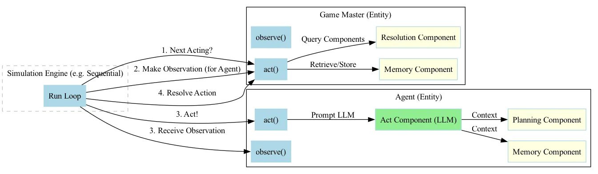
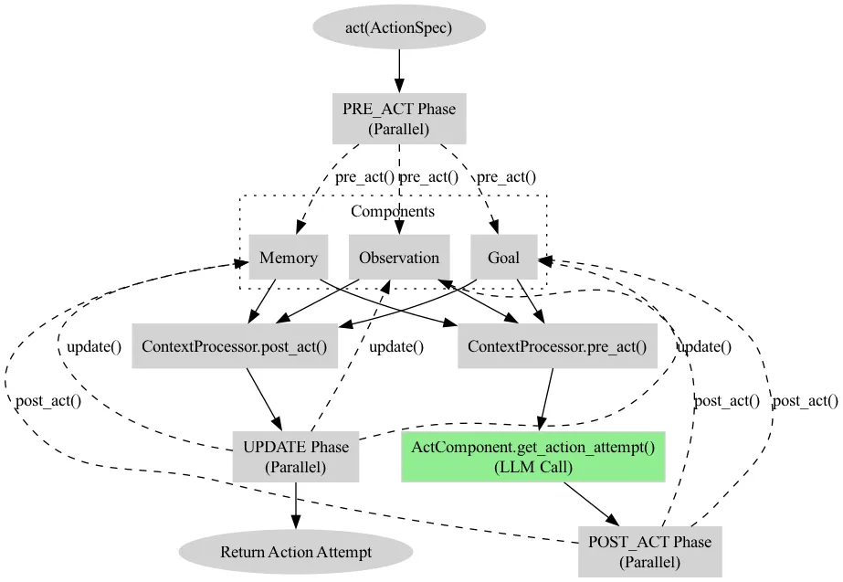
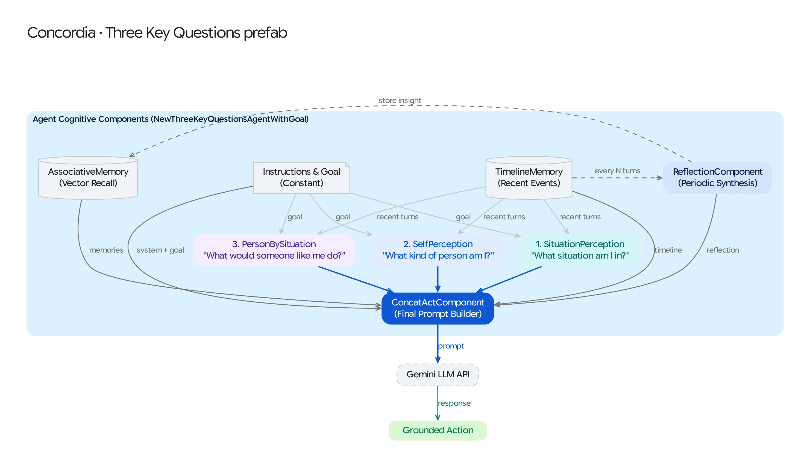

# Concordia: A Primer for Generative Social Simulation

Concordia is a library for building **generative agent-based models**. It simulates social interactions by combining Large Language Models (LLMs) with a modular architecture inspired by game engines and tabletop role-playing games (TRPGs).

---

## 1. The Core Analogy: The Tabletop RPG

The best way to understand Concordia is through the lens of a Tabletop RPG (like Dungeons & Dragons):

*   **Players (Agents)**: These are the entities in the simulation. They have personalities, memories, and goals. They interact by describing what they want to do in natural language.
*   **Game Master (GM)**: A special entity responsible for the "world." The GM describes what the players see, decides who goes next, and resolves the outcomes of player actions.
*   **The Engine**: The set of rules that governs turn-taking, time, and how the GM and Players interact.

---

## 2. Architecture: Entity, Component, Engine

Concordia follows a pattern similar to **Entity-Component-System (ECS)** found in game engines, but adapted for LLM-driven agents.

### Entities
An `Entity` is any actor in the simulation. In Concordia, both Agents and Game Masters are Entities.
*   **Name**: A unique identifier.
*   **Act**: A method to produce an action based on a prompt (`ActionSpec`).
*   **Observe**: A method to receive information from the world.

### Components
Functionality is added to Entities via **Components**. This is pure composition.
*   **Context Components**: Provide "context" for an action (e.g., Memory, Current Observation, Internal Goals).
*   **Acting Components**: The "brain" that actually calls the LLM, using the gathered context to decide on an action.
*   **Lifecycle Hooks**: Components have hooks like `pre_act`, `post_act`, `pre_observe`, and `update`.

### Engine
The `Engine` is the orchestrator. it manages the loop:
1.  **Observation**: The GM generates observations for each agent.
2.  **Selection**: The GM decides which agent acts next.
3.  **Action**: The selected agent acts.
4.  **Resolution**: The GM describes the result of the action.

---

## 3. The Agent Lifecycle

When an agent is asked to `act()`, it goes through a multi-phase internal process:

1.  **PRE_ACT**: The agent calls `pre_act()` on all its components in parallel.
    -   *Memory Component*: "What relevant memories do I have for this situation?"
    -   *Goal Component*: "What am I trying to achieve right now?"
    -   *Observation Component*: "What did I just see?"
2.  **GET_ACTION**: The `ActComponent` takes all the strings returned by the components and builds a prompt for the LLM. The LLM returns the action.
3.  **POST_ACT**: The agent updates its memory with the action it just took.
4.  **UPDATE**: Any background components (like emotional state or health) are updated based on the elapsed time.

---

## 4. The "Three Key Questions" Reasoning Pattern

In Concordia, the GM is **just another Entity** with specialized components. Instead of "What do I do next?", the GM is asked:
*   `MAKE_OBSERVATION`: "What does Alice see right now?"
*   `NEXT_ACTING`: "Which player should go next?"
*   `RESOLVE`: "Alice tried to buy a cookie; what actually happened?"

Because the GM is an Entity, it also has **Memory**. It remembers the history of the world and uses that history to ensure consistency.

---

## 5. Memory: Associative and Embeddings

Agents don't remember everything at once (that would exceed LLM context limits). Instead, they use **Associative Memory**:
1.  **Storage**: Every observation and action is stored in a memory bank.
2.  **Embedding**: Each memory is turned into a vector (embedding).
3.  **Retrieval**: When an agent needs to act, it takes the current situation, embeds it, and finds the most similar vectors in its memory bank.
4.  **Context**: Only the most relevant memories are sent to the LLM.

---

## 6. Adapting to Go (Pandemonium)

If you are looking to implement a Go version of this library, see the dedicated [Go Adaptation Guide](GO_ADAPTATION.md) for architectural details, concurrency patterns, and library structure.

---

## 7. Prefabs and the "Three Key Questions"

Creating an agent from scratch by manual wiring is tedious. Concordia uses **Prefabs** to bundle common configurations.

A famous pattern in Concordia is the **"Three Key Questions"** agent, which mirrors human social reasoning:
1.  **Self-Perception**: "What kind of person am I?"
2.  **Situation Perception**: "What situation am I in right now?"
3.  **Decision**: "What would a person like me do in a situation like this?"

These are implemented as separate components.
 The "Decision" component depends on the output of the first two. This chain of reasoning makes the agent's behavior much more consistent and "human-like" than a single-shot prompt.

---

## 8. Upstream Concordia Reference (`google-deepmind/concordia`)

For the reference Python implementation in [`google-deepmind/concordia`](https://github.com/google-deepmind/concordia) (or a local checkout at `../github/concordia`):

*   `concordia/typing/`: The core protocols (`ActionSpec`, `Entity`, `Component`).
*   `concordia/agents/`: The `EntityAgent` and `EntityAgentWithLogging` implementations.
*   `concordia/components/agent/`: Concrete building blocks (`AssociativeMemory`, `LastNObservations`, `QuestionOfRecentMemories`, `pubsub`).
*   `concordia/environment/engines/`: The orchestration loops (`Sequential`, `Simultaneous`, `Asynchronous`) and `StepController`.
*   `concordia/prefabs/`: Prebuilt `Entity` (`basic`, `rational`, `basic_with_async_deliberation`) and `GameMaster` (`generic`, `interrupt_driven`) templates.
