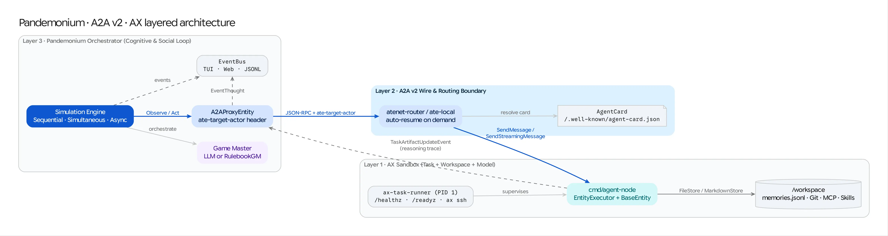

# Tutorial 06: Running AX-Sandboxed Simulations over A2A v2

In this tutorial, you will combine **Pandemonium**, **A2A v2**, and **AX** (`~/projects/ax`) so that a remote Pandemonium agent (`Bob`) runs inside an isolated **AX `Task` sandbox** with durable `/workspace` memory persistence, `ate-target-actor` routing, and live `ax suspend` / `ax resume` lifecycle control.

For the full architectural breakdown across all three integration perspectives, see [Combining Pandemonium, A2A v2, and AX](../AX_A2A_INTEGRATION.md).



---

## Step 1: Cross-Compile `agent-node` for the AX Sandbox (`linux/arm64`)

On macOS with Apple silicon (`ate-local` / Apple `container`), AX containers run `linux/arm64`. Cross-compile `cmd/agent-node` as a static Linux binary:

```bash
cd go
GOOS=linux GOARCH=arm64 CGO_ENABLED=0 go build -o ../examples/ax/agent-node-linux-arm64 ./cmd/agent-node
cd ..
```

---

## Step 2: Start the Local AX Control Plane (`ate-local`)

In a separate terminal pointing at your `~/projects/ax` checkout, start the local AX stack (`Valkey` + `ate-local` + `ax-server`):

```bash
cd ~/projects/ax
make local-up
source .ax-local/env
```

---

## Step 3: Apply the AX `Task` & `Workspace` Manifest

Inspect [`examples/ax/pandemonium-agents.yaml`](../../examples/ax/pandemonium-agents.yaml). It uses **Option 1 (zero module coupling)**:
- `ax-task-runner` runs as PID 1 inside the container (serving `/healthz`, `/readyz`, and `ax ssh` guest services).
- `spec.command` launches `/workspace/agent-node -port 9001 -config /workspace/bob-agent.yaml`.
- [`examples/ax/bob-agent.yaml`](../../examples/ax/bob-agent.yaml) configures Bob's `FileStore` at `/workspace/bob_memories.jsonl` on AX's durable `/workspace` volume.

Apply and resume the task:

```bash
cd ~/projects/pandemonium
ax apply -f examples/ax/pandemonium-agents.yaml
ax resume agent-bob
ax get tasks
```

**Checkpoint**: Note the `WORKER-IP` (`192.168.64.x`) assigned to `agent-bob`, and verify the sandbox over `ax ssh` and `a2acli`:

```bash
# Inspect inside the AX container via ax ssh
ax ssh agent-bob -- ls -la /workspace

# Discover Bob's A2A v2 AgentCard
a2acli discover --service-url http://<WORKER-IP>:9001
```

> **Note (Cluster `atenet-router` Mode)**: When running against an AX Kubernetes cluster with `atenet-router` port-forwarded on `localhost:8001`, you do not need a worker IP—`examples/ax/ax_distributed_pub.yaml` includes `ate_target_actor: "default/agent-bob"`, which instructs `A2AProxyEntity` to attach the `ate-target-actor: default/agent-bob` header on every request and automatically wakes `agent-bob` if suspended.

---

## Step 4: Run the Pandemonium Orchestrator Against the AX Sandbox

Update `url` in `examples/ax/ax_distributed_pub.yaml` to `http://<WORKER-IP>:9001/invoke` (or `http://localhost:8001/invoke` when routing through `atenet-router`), then start Pandemonium in paused mode:

```bash
cd go
go run ./cmd/pandemonium \
  -scenario ../examples/ax/ax_distributed_pub.yaml \
  -start-paused \
  -web ../web/dist
```

1. Open **`http://localhost:8080`** in your browser.
2. Click **`⏭ Step`** twice so both `Alice` (local) and `Bob` (inside the AX sandbox) complete a turn.
3. Click on `Bob`'s thought event in the Web Command Center to inspect the reasoning artifacts (`Instructions`, `Goal`, `Memory`, `Timeline`, `SituationPerception`, `SelfPerception`, `PersonBySituation`) tunneled out of the AX sandbox over A2A v2!

---

## Step 5: Verify `/workspace` Persistence Across `ax suspend` & `ax resume`

While Pandemonium is paused between steps:

1. **Inspect Bob's durable memory inside the AX container**:
   ```bash
   ax ssh agent-bob -- cat /workspace/bob_memories.jsonl
   ```
   Verify that Bob's observations and actions have been written to `/workspace/bob_memories.jsonl`.

2. **Suspend and Resume the AX Task**:
   ```bash
   ax suspend task agent-bob
   ax get tasks   # PHASE: Suspended (container stopped, CPU/RAM freed)

   ax resume agent-bob
   ax get tasks   # PHASE: Running (/workspace restored)
   ```

3. **Continue the Simulation**:
   Click **`▶ Play`** (or **`⏭ Step`**) in the Web Command Center at `http://localhost:8080` and verify that Bob seamlessly continues the simulation with his prior memories reloaded from `/workspace/bob_memories.jsonl`.
